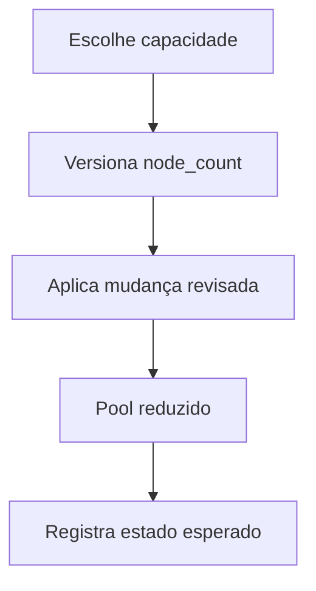

  

# Redução de nós

A redução muda a capacidade de executar aplicações sem equivaler à destruição de toda a infraestrutura.

Sem apply, a mudança no Git não altera a nuvem. Reduzir a zero interrompe workloads, mas não remove automaticamente control plane, endereços ou outros recursos cobrados. Falhas operacionais precisam ser conciliadas com o state.
