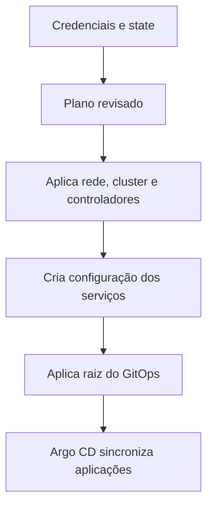

  

# Preparação do cluster

A infraestrutura base é preparada antes das aplicações.

Permissão insuficiente, rede não autorizada, segredo ausente e falha de chart impedem concluir a preparação. O [fluxo central](https://github.com/Solierrr/docs-warehouse/blob/main/docs/flows/RELEASE_AND_DEPLOY.md) contextualiza as aplicações.
