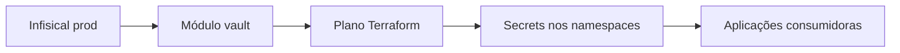

  

# Sincronização de configuração

O plano lê configuração autorizada do cofre e materializa os Secrets usados pelas aplicações.

Credencial sem acesso à pasta, nome divergente e namespace incorreto impedem o consumo. Os conteúdos não devem aparecer nos documentos ou commits.
